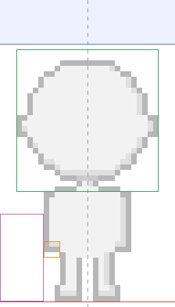

# Art spec: the MapleStory-style redraw

How to make the new art so it drops into the app with no code changes.
The art is made with AI image tools and cleaned up by hand. Check every
file with `npm run check:art` before committing it.

## The look

Inspired by MapleStory: chibi characters with a big round head (about
half their height), a small body, big shiny eyes, soft two-tone shading,
clean dark outlines, bright friendly colors, and light from the top left.

**Never use MapleStory's own art.** It belongs to Nexon. Sites like
maples.im show the real game sprites (from maplestory.io), so they're
fine to look at for style, but don't trace them, don't paste them into
an AI tool as a reference image, and don't copy a recognizable item or
monster exactly. Describe the style in words, and once our own first
character is approved, use *that* as the reference image for everything
after it.

- **Outlines:** dark brown-gray (about `#3a2a2a`), never pure black.
  About 6 px wide on the 256 px canvas, a little thinner on small
  details (fingers, eyes).
- **Shading:** a base color, one shadow tone (bottom right), and a small
  highlight (top left). Soft edges between tones are fine; no gradients
  across a whole shape, no textures, no noise.
- **Edges:** smooth and anti-aliased. No pixel-art look anywhere.
- **Pose:** the character faces the viewer, standing straight, arms at
  the sides, feet together. Every layer is drawn on this one pose, so
  items line up.

## Canvas and units

The app lays everything out in *units*. Each image covers a fixed number
of units but is stored at 8 pixels per unit:

| Art | Units | New PNG size | Notes |
|---|---|---|---|
| Avatar layer | 32 x 56 | **256 x 448** | Every avatar layer, even small ones like glasses |
| Pet frame | 16 x 16 | **128 x 128** | Two frames per pet |
| Badge piece | 22 x 22 | **176 x 176** | A frame plus a symbol |
| Goal flag | 12 x 24 | **96 x 192** | `assets/track/flag_goal.png` |

Any whole multiple works (the checker accepts 4x or 16x too), but use 8x
for everything so the outlines match. The old pixel art is 1x; old and
new files can be mixed while the redraw is in progress.

All PNGs: RGBA, 8-bit, transparent background, not interlaced.

## Avatar layers

Open `docs/art-template.png` (256 x 448) and draw over it. The guides:

| Guide | Where (8x pixels) | Meaning |
|---|---|---|
| Blue band, top | y 0-63 | Headroom: only tall things go here (hats, ears, raised items) |
| Green box | x 24-231, y 72-279 | The head. Faces must fit on it; the shop shows faces on this box |
| Dashed line | x 128 | Center. The body is symmetric around it |
| Orange box | x 64-87, y 352-375 | The hand that holds `hand_` items (the viewer's left) |
| Red line | y 440 | Feet stand on this line. Nothing below it |
| Purple box | x 0-63, y 312-439 | Where the pet walks. Things that hang here (capes, long hair) push the pet further left, which works but looks crowded |

### Layer order

Drawn back to front (from `src/avatar/Avatar.tsx`):

1. cape **back**
2. hair **back**
3. hand item **back**
4. **body** (tinted with the skin color)
5. bottom (skipped when wearing an outfit)
6. shoes
7. top, or the outfit instead
8. face
9. glasses
10. hair (tinted with the hair color)
11. hat
12. cape
13. hand item

A **back** file (`name_back.png`) is the part of an item that is behind
the body: the far side of a cape, the hair behind the shoulders, a
fishing rod's line. Only the items that have one now need one.

Because a top is drawn over the bottom and shoes, a top may cover the
waistband, but a bottom must never cover the top. A hat is drawn over
the hair: draw the hat so it hides any hair under it, and draw hair so
it looks fine under a hat (no huge spikes on top for short styles).

### Tinted layers: body and hair

The app colors `body_base.png` and every `hair_*.png` by multiplying
them by the player's chosen color. So these are **grayscale only** (the
checker rejects color):

- Light areas near white (`#f0f0f0` to `#ffffff`) turn into the chosen
  color exactly.
- Shadows mid gray (about `#c4c4c4`).
- Outlines stay dark gray (about `#3a3a3a`) and look dark on any color.
- Hair: keep the base a little below white (about `#e6e6e6`) so a pure
  white shine streak still shows on it.

Faces are not tinted: eyes, brows, mouth and blush in their real colors,
on a transparent background (no skin).

### Per slot

| Slot | Files | Rules |
|---|---|---|
| body | `body_base` | Grayscale. Head, ears, neck, torso, arms, legs, feet. No clothes, no face |
| face | `face_*` | Eyes, brows, mouth, blush only. Same eye position on every face |
| hair | `hair_*` (+ `_back`) | Grayscale. Front: bangs and sides over the face. Back: everything behind the head and shoulders |
| top | `top_*` | Shirt and sleeves over the arms |
| bottom | `bottom_*` | Waist to ankle (or knee). Under the top |
| shoes | `shoes_*` | Both feet, standing on the red line |
| hat | `hat_*` | May use the headroom |
| glasses | `glasses_*` | On the eyes; check them with a few hairstyles |
| cape / wings | `cape_*`, `wings_*` (+ `_back`) | Front: the collar and anything over the shoulders. Back: the rest |
| hand | `hand_*` (+ `_back`) | Held at the orange box. Long things may go into the headroom |
| outfit | `outfit_*` | Top and bottom in one image, used instead of both |

Keep every existing file name. `ls assets/avatar` is the full list:
107 files (93 items and 14 backs).

## Pets

`assets/pets/name_a.png` and `name_b.png`, 128 x 128, facing **right**
(the way the character walks). Feet on the bottom 8 px rows. Frame b is
the in-between step of a little walking bounce (squash, a leg forward,
a tentacle wiggle). Pets keep their current personalities (see the notes
in `src/avatar/pets.ts`), only the look changes.

## Badges

`assets/badges/`, 176 x 176 each. A medal frame (`badge_frame`) and one
symbol per kind, drawn on top of it: the symbol must look right centered
on the frame. Every file also needs a `_locked` copy: the same image in
flat grays at lower contrast.

## Maps

Sizes are in points. Each image is needed at 1x, @2x and @3x (for
example `tile_a.png` 512 x 160, `tile_a@2x.png` 1024 x 320,
`tile_a@3x.png` 1536 x 480). Make the @3x one and scale it down for the
other two.

| File | Points | |
|---|---|---|
| `tile_a`, `tile_b` | 512 x 160 | Road and scenery; repeat side by side |
| `start`, `mid`, `goal`, `far` | 128 x 144 | Landmarks standing on the road |

Rules that keep the map seamless with the colors the app paints:

1. **Transparent above the scenery.** The app paints the sky in the
   theme's `sky` color (`src/track/themes.ts`).
2. **The bottom 48 points are road**; the bottom 16 points are the
   theme's exact `ground` color, flat, with no outline along the bottom
   edge.
3. **Left and right edges match**, so tiles repeat without a seam.
4. Calmer than the characters: softer outlines (never black), lower
   contrast, so the characters stand out.

(Gradient skies and layered backgrounds that scroll at different speeds,
as in MapleStory, need a code change. Ask before drawing for them.)

## AI workflow

1. **Lock the base first.** Generate the bare body, one face and one
   hairstyle. Clean them up, put them in the app, and check on a phone.
   Everything else is drawn on this body, so don't continue until it's
   approved. A stand-in base drawn in code is already in the app
   (`scripts/draw-base-art.mjs`: `body_base`, `face_smile`,
   `hair_spiky`); render it big and use it as the pose reference.
2. **Generate big, on the template pose.** Give the tool the approved
   base character as the reference image, generate at 2x or 4x
   (512 x 896 or 1024 x 1792), and scale down to 256 x 448 at the end.
   Ask for a flat background (pure white or a single color) unless the
   tool can export transparency.
3. **Generate the item worn, then cut it out.** It's easier to get
   "the base character wearing a red hoodie" right than a hoodie on its
   own. Put the result over the base in an image editor, line it up,
   erase everything that isn't the item, and split off the back part if
   it has one.
4. **Fix the outlines by hand.** AI output wobbles: even out line width,
   match the outline color, remove stray pixels and soft halos left by
   background removal.
5. **Check on the app's tint.** For body and hair, convert to grayscale
   and try a few skin and hair colors in the app.
6. **Run `npm run check:art`**, then `npm run preview:avatar -- out.png`
   to see the starter looks in several skin and hair colors, drawn the
   way the app draws them. Then try the item on a couple of outfits in
   Customize before committing.

A prompt to start from (keep it the same for every item, change only the
last sentence):

> Cute chibi game character art in the style of a 2D side-scrolling MMO:
> big round head about half the body height, small body, large shiny
> eyes, clean dark brown outlines, soft two-tone cel shading, light from
> the top left, bright friendly colors, smooth anti-aliased edges, not
> pixel art. Full body, facing the viewer, standing straight with arms
> at the sides, plain white background, nothing else in the image.
> The character is wearing: a red zip-up hoodie.

## Order

1. Base: body, one face, one hair (then stop and check on a phone).
2. The rest of the faces and hair, then tops, bottoms, shoes and outfits.
3. Hats, glasses, capes, wings, hand items.
4. Pets, badges, the goal flag.
5. Maps, one theme at a time.
